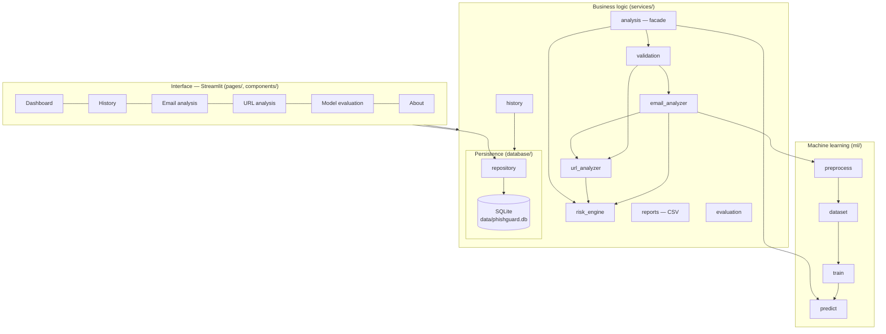
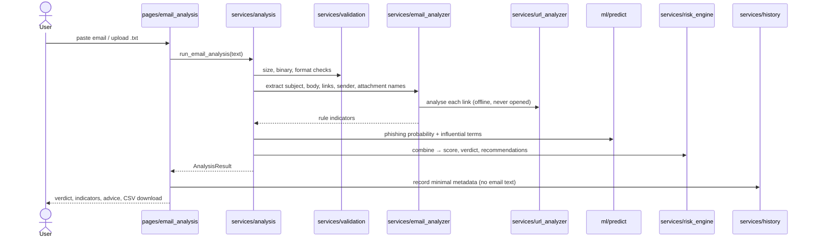

# PhishGuard AI — Architecture

## Layers

The code is split into four layers. Each layer only calls the layers below it; the interface
holds no business logic.

| Layer | Folder | Responsibility |
|---|---|---|
| Interface | `app.py`, `pages/`, `components/` | Navigation, theme, display, charts. Calls the services only. |
| Business logic | `services/` | Validation, email and URL indicators, risk scoring, history recording, CSV reports. |
| Machine learning | `ml/` | Parsing and normalisation (shared by training and inference), dataset building, training and evaluation, prediction with integrity check. |
| Persistence | `database/` | SQLite schema and parameterised queries. |
| Configuration | `config/settings.py` | Every tunable value, overridable through `PHISHGUARD_*` environment variables. |
| Scripts | `scripts/` | Command-line tools: data preparation, engine evaluation, demo seeding. |

## Flow of an email analysis

## Training pipeline

```mermaid
flowchart LR
    RAW["data/raw/<br/>SpamAssassin ham<br/>Nazario mbox"] --> PREP["scripts/prepare_data<br/>parse · drop headers · scrub artifacts<br/>· deduplicate"]
    PREP --> CSV["data/processed/<br/>emails.csv"]
    CSV --> SPLIT["grouped stratified split<br/>(group = subject, seed 42)"]
    SPLIT --> CV["5-fold group CV on train:<br/>Naive Bayes vs linear SVM"]
    CV --> FIT["refit best on train"]
    FIT --> TEST["single evaluation<br/>on held-out test"]
    TEST --> OUT["models/phishing_model.joblib<br/>models/model_metadata.json<br/>reports/*"]
    OUT --> ENG["scripts/evaluate_engine<br/>(AI + rules on same test set)"]
```

## Risk score

* URL: `risk = rules`, where `rules = 1 − ∏(1 − weightᵢ)` (noisy-OR of the indicator weights).
* Email: `risk = max(w·p_AI + (1 − w)·rules, 0.9·rules)`, with `w = 0.5` by default.
* Verdict: below 0.40 is *Likely legitimate*; 0.40 to 0.70 is *Suspicious*; 0.70 and above is *Likely phishing*.

## Data stored

Table `analyses` (SQLite):

| Column | Notes |
|---|---|
| `public_id`, `created_at` (UTC), `analysis_type`, `verdict` | |
| `risk_score`, `rule_score`, `ml_probability`, `model_version` | Database constraints keep the scores between 0 and 1. |
| `target` | The URL host or the email sender domain. |
| `signal_codes`, `num_signals` | The indicators that fired. |
| `metadata_json`, `duration_ms` | Minimal metadata (counts, flags) and the analysis time. |
| `content` | **NULL** unless `PHISHGUARD_STORE_EMAIL_BODY=true`. |

## Generated artifacts

| File | Produced by | Contents |
|---|---|---|
| `data/processed/emails.csv`, `dataset_stats.json` | `scripts/prepare_data` | The cleaned dataset (git-ignored). |
| `models/phishing_model.joblib` | `ml/train` | The fitted pipeline (git-ignored, regenerated). |
| `models/model_metadata.json`, `reports/metrics.json` | `ml/train` | Version, dataset, split, CV results, test metrics, SHA-256. |
| `reports/evaluation_report.md` | `ml/train` | The model evaluation report. |
| `reports/test_split.json` | `ml/train` | The IDs of the held-out test emails. |
| `reports/engine_metrics.json`, `engine_evaluation.md` | `scripts/evaluate_engine` | The full-engine evaluation. |
| `reports/test_results.txt` | `pytest` (see README) | Test and coverage results. |
